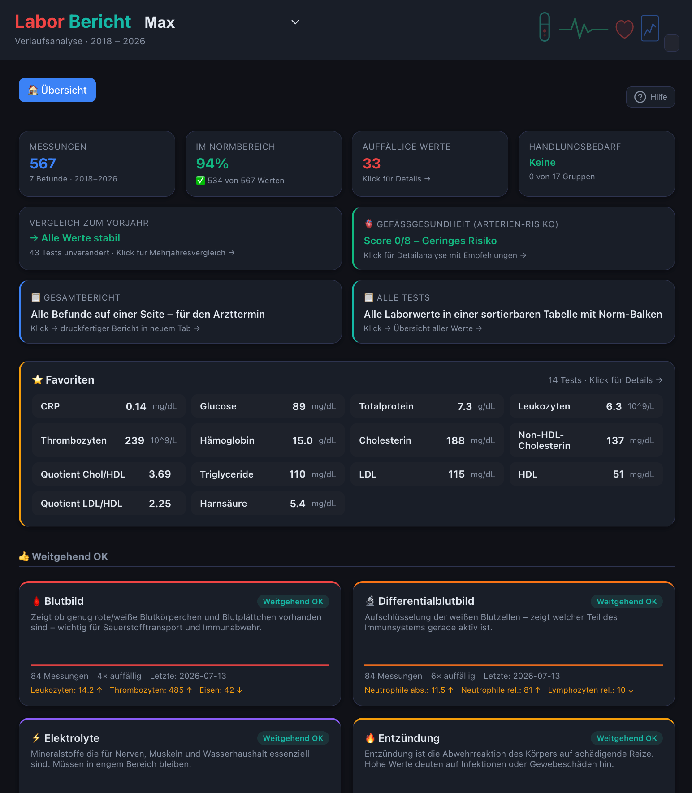

# hc_med – Laborwerte Dashboard


[](https://github.com/zibous/hc_med/releases)
[](https://github.com/zibous/hc_med)
[](https://python.org)
[](https://fastapi.tiangolo.com)
[](https://hub.docker.com)
[](https://mqtt.org)
[](https://sqlite.org)
[](https://www.chartjs.org)
[](#)
[](#)
[](#)
[](#)
[](https://www.buymeacoff.ee/zibous)




Langzeit-Verlaufsanalyse von Laborwerten (2013–2026) mit automatischer Extraktion aus verschiedenen Befund-Formaten, SQLite-Datenbank, interaktivem Web-Dashboard und druckbarem Arztbericht.

**Multi-User**: Jeder Patient hat ein eigenes Datenverzeichnis mit separater DB. User-Wechsel per Dropdown im Header (Cookie-basiert).

## Übersicht

```
┌─────────────────────────────────────────────────────────────────────────┐
│                         hc_med – Architektur                            │
├─────────────────────────────────────────────────────────────────────────┤
│                                                                         │
│  ┌──────────────┐     ┌──────────────┐     ┌────────────────────────┐   │
│  │  Befund-TXT  │────▶│  Parser      │────▶│  SQLite (per User)     │   │
│  │  PDF → Text  │     │  7 Formate   │     │  data/user/{id}/       │   │
│  │  hc_scale DB │     │  Validierung │     │  labor.db              │   │
│  └──────────────┘     └──────────────┘     └────────────┬───────────┘   │
│                                                         │               │
│                                                         ▼               │
│                              ┌───────────────────────────────────┐      │ 
│                              │  FastAPI Backend (Port 5065)      │      │
│                              │  Middleware: User aus Cookie      │      │
│                              │  ContextVar → get_db() per User   │      │
│                              └───────────────┬───────────────────┘      │
│                                              │                          │
│                                              ▼                          │
│                              ┌───────────────────────────────────┐      │
│                              │  Frontend (Chart.js + ES6)        │      │
│                              │  User-Selector · Drilldown        │      │
│                              │  Verknüpfungen · Arztbericht      │      │
│                              └───────────────────────────────────┘      │
│                                                                         │
└─────────────────────────────────────────────────────────────────────────┘
```

## Multi-User Konzept

Jeder User hat ein eigenes Verzeichnis unter `data/user/{id}/`:

```
data/
├── labor_config.yaml          ← Shared: Gruppen, Tests, Verknüpfungen
├── userlist.yaml              ← User-Stammdaten + scaledb-Pfade
└── user/
    ├── guest/                 ← Demo-User (wird versioniert)
    │   ├── import/            ← Befund-Dateien (.txt, .csv)
    │   └── favoriten.yaml
    ├── peter/                 ← Echte Patientendaten (gitignored)
    │   ├── import/            ← Befund-Dateien
    │   ├── labor.db           ← SQLite DB (generiert)
    │   ├── laborwerte_gesamt.csv
    │   └── favoriten.yaml
    └── reni/
        ├── import/
        └── favoriten.yaml
```

**User-Auswahl**: Cookie `hc_user` → Middleware setzt ContextVar → `get_db()` gibt automatisch die richtige DB zurück. Kein Umbau der API-Endpoints nötig.

## Datenverarbeitung – Pipeline

```
  data/user/{id}/import/*.txt + hc_scale DB
        │
        ▼
┌───────────────────────────────────────────────────────┐
│  1. FORMAT-ERKENNUNG (7 Formate automatisch)          │
│  2. PARSING (pro Format ein Parser)                   │
│  3. NORMALISIERUNG (Testnamen, Einheiten, rel/abs)    │
│  4. VALIDIERUNG (Plausibilitäts-Ranges)               │
│  5. AUSGABE → data/user/{id}/labor.db + CSV           │
└───────────────────────────────────────────────────────┘
```

## App-Architektur (Clean Architecture)

```
app/
├── main.py                      # FastAPI, Middleware (User-Cookie), Router
├── api/                         # Router (je ein Endpoint-Bereich)
│   ├── overview.py              /overview
│   ├── gruppe.py                /gruppe/{name}
│   ├── trend.py                 /trend/{test}
│   ├── verknuepfung.py          /verknuepfungen, /verknuepfung/{name}
│   ├── pathologisch.py          /pathologisch
│   ├── bericht.py               /bericht, /bericht/charts
│   ├── gesamtbericht.py         /gesamtbericht
│   ├── favoriten.py             /favoriten (per User)
│   ├── vergleich.py             /vergleich
│   ├── alle_tests.py            /alle-tests
│   ├── kpidata.py               /kpidata (für dbo)
│   └── tests_router.py          /tests
├── config/
│   └── settings.py              YAML-Config + get_patient_config()
├── core/                        # Business Logic
│   ├── bewertung.py             Bewertungslogik
│   ├── empfehlungen.py          Empfehlungslogik
│   ├── vergleich.py             Vorjahresvergleich
│   ├── gesamtbericht_data.py    Report-Assembly
│   └── norm_bar.py              Normbereich-Visualisierung
└── infrastructure/
    └── database.py              ContextVar-basiert, Multi-User get_db()
```

## Projektstruktur

```
hc_med/
├── app/                         # Backend (FastAPI)
├── frontend/
│   ├── templates/               # Jinja2 (index, Berichte)
│   └── static/
│       ├── css/                 # theme.css (shared) + style.css
│       └── js/                  # ES6 Modules (main.js → bundle)
├── scripts/
│   ├── extract_labvalues.py     # Parser (7 Formate), Aufruf: python3 ... {user}
│   ├── labor_db.py              # SQLite DB-Modul (Schema, Import)
│   ├── import_scale.py          # Körperdaten aus hc_scale (per User)
│   └── validate_labor.py        # Plausibilitätsprüfung (per User)
├── data/
│   ├── labor_config.yaml        # Shared Config (Gruppen, Tests, Empfehlungen)
│   ├── userlist.yaml            # User-Stammdaten + scaledb-Pfade
│   └── user/{id}/               # Pro-User Daten
├── docs/
│   └── nginx_hc_med.conf
├── Dockerfile
├── docker-compose.yml
├── Makefile
└── requirements.txt
```

## Konfiguration

### data/userlist.yaml

```yaml
patient:
  peter:
    vorname: "Hans-Peter"
    nachname: "Siebler"
    geburtsdatum: "yyyy-mm-dd"
    geschlecht: "m"
    scaledb: ../../hc_scale/data/miscaledata.db

  reni:
    vorname: "Reni"
    nachname: "Siebler"
    geburtsdatum: "yyyy-mm-dd"
    geschlecht: "w"
    scaledb: ../../hc_scale/data/miscaledata.db

  guest:
    vorname: "Max"
    nachname: "Mustermann"
    geburtsdatum: "1960-10-16"
    geschlecht: "m"
    scaledb: ""
```

### data/labor_config.yaml (shared)

```yaml
gruppen:                    # Gruppen-Icons, Farben, Beschreibungen
tests:                      # Test-Beschreibungen
ereignisse:                 # KH-Aufenthalte (Marker im Chart)
verknuepfungen:             # Zusammenhänge zwischen Tests
empfehlungen_tests:         # Test-spezifische Empfehlungen
kurznamen:                  # Kurzbezeichnungen für Tabellen
nuechtern_sensitiv:         # Tests die nüchtern-sensitiv sind
```

## Dashboard – Navigation

```
ÜBERSICHT (KPIs + Gruppen sortiert nach Status)
    │
    ├── Klick Gruppe ──▶ GRUPPEN-DETAIL (Tests mit Sparklines, Bewertung)
    │       │
    │       └── Klick Test ──▶ TREND-CHART (Norm-Band, Marker, Empfehlung)
    │               │
    │               └── Klick Zusammenhang ──▶ MULTI-CHART (mehrere Tests)
    │
    ├── Klick "Auffällige Werte" ──▶ TABELLE (sortierbar, filterbar)
    │       │
    │       └── Klick Zeile ──▶ TREND-CHART
    │
    └── Klick "Bericht drucken" ──▶ ARZTBERICHT (HTML/PDF mit Charts)
```

## Features

- **Multi-User** mit Cookie-basiertem User-Wechsel (Dropdown im Header)
- **7 Befund-Formate** automatisch erkannt und geparst
- **Körperdaten** aus Mi Scale Waage (hc_scale Integration, per User)
- **Normalisierung** (Testnamen, Einheiten, HbA1c NGSP/IFCC)
- **Validierung** mit medizinischen Plausibilitäts-Ranges
- **Bewertung** aktuell (letzte 5 Werte) + historisch
- **Alters-/Geschlechtskontext** in allen Beschreibungen
- **Verknüpfungen** mit Multi-Charts und personalisierten Empfehlungen
- **Gefäßgesundheit-Score** (Radar-Chart + Faktoren-Aufschlüsselung)
- **Krankenhaus-Marker** im Verlaufs-Chart
- **Druckbarer Arztbericht** (PDF via Browser-Druckdialog)
- **Gesamtbericht** mit Gruppen-Ampel und abnormen Trends
- **Favoriten** (Stern-Markierung, per User gespeichert)
- **Mehrzeitraum-Vergleich** (1–5 Jahre Pivot-Tabelle)
- **KPI-Integration** ins übergeordnete DBO-Dashboard
- **Dark/Light Theme** (shared mit allen HomeApps Dashboards)
- **State-Persistenz** (Refresh behält aktuelle View)

## Makefile-Befehle

```bash
# Server
make dev              # Uvicorn starten (Port 5065, --reload)
make up               # Docker Container starten
make restart          # Docker Container neustarten

# Daten (USER=peter ist Default)
make labor USER=peter        # Befunde parsen → labor.db
make labor-reset USER=peter  # DB löschen + Neuaufbau + Scale + Validierung
make labor-reset USER=reni   # Für Reni
make labor-validate USER=peter  # Nur Plausibilitätsprüfung

# Build
make jsbuild          # JS/CSS bundeln (esbuild via Docker)
make deploy           # jsbuild + restart

# Git
make git-update       # Commit + Push zu Forgejo
make git-release      # Version-Tag + Push
```

## Neuen User anlegen

1. In `data/userlist.yaml` eintragen (Stammdaten + scaledb)
2. Verzeichnis anlegen: `mkdir -p data/user/{id}/import`
3. Befund-Dateien in `data/user/{id}/import/` ablegen
4. `make labor-reset USER={id}`
5. Im Dashboard über Dropdown auswählen

## Neue Befunde hinzufügen

1. Textdatei in `data/user/{id}/import/` ablegen (Format: `YYYY-MM-DD_laborbefund_quelle.txt`)
2. `make labor-reset USER={id}`
3. Dashboard zeigt neue Werte automatisch

## Nginx (extern + Auth)

```bash
# Config: siehe docs/nginx_hc_med.conf
# LAN (10.1.1.x): kein Login
# Extern: Basic Auth
# /api/kpidata: immer offen (für DBO)
```

## Technologie

- **Backend**: Python 3.12, FastAPI, SQLite, Jinja2, PyYAML
- **Frontend**: Vanilla JS (ES6 Modules), Chart.js, CSS Custom Properties
- **Theme**: HomeApps Unified Theme (Dark/Light)
- **Deploy**: Docker oder direkt Uvicorn, Nginx Reverse-Proxy
- **Daten**: hc_scale (Waage), Laborbefund-Textdateien (7 Formate)
